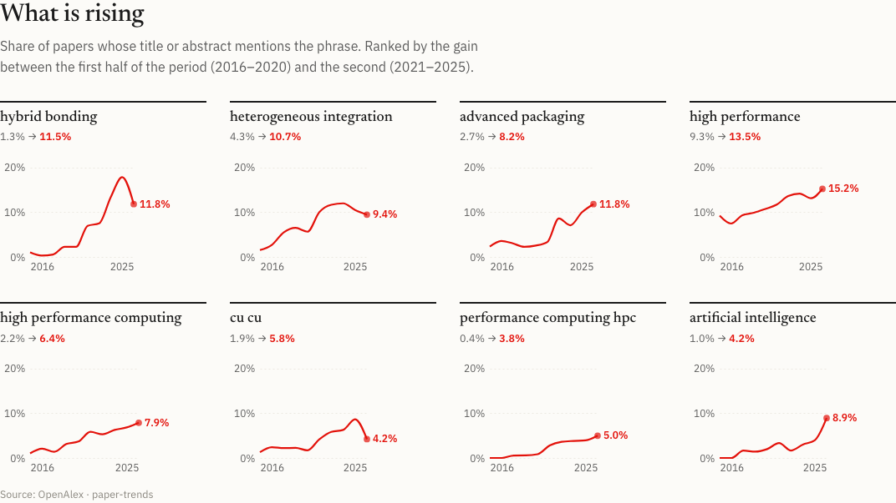
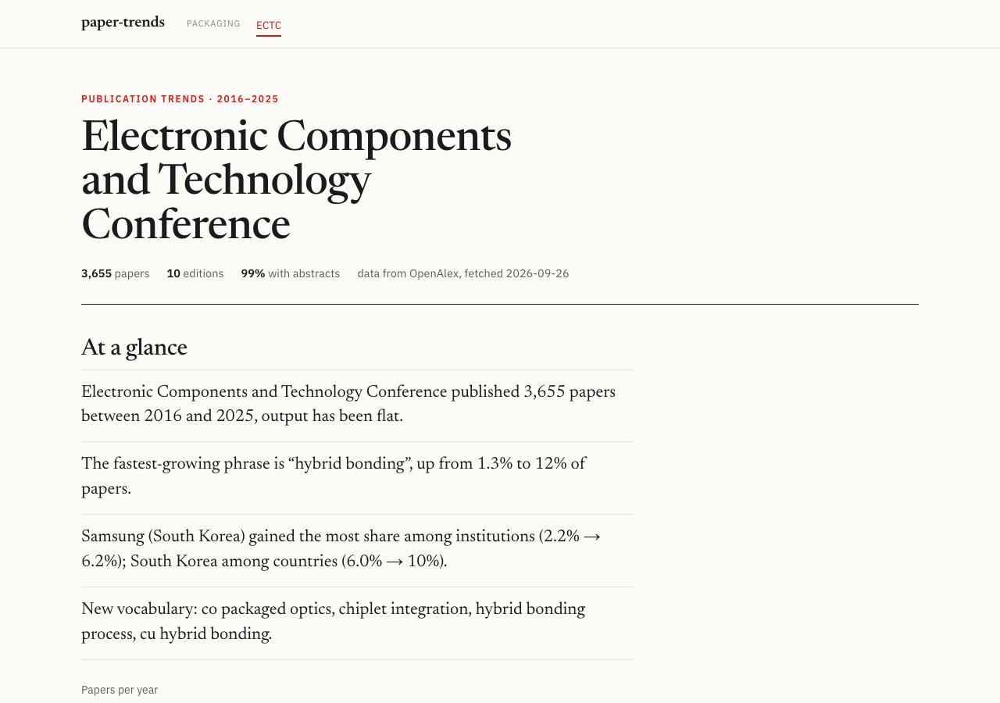

# paper-trends

Publication-trend analysis for **any academic conference**, built on the free, CC0-licensed
[OpenAlex](https://openalex.org) API.

Give it a conference name and it fetches every paper the venue has published, then
reports keyword trends, topic evolution, and institution / author / country rankings.

First showcase: **ECTC (IEEE Electronic Components and Technology Conference), 2016–2026**.
The same command works for ISSCC, IEDM, or any other venue indexed by OpenAlex.

> Status: early but usable. Command-line tools for fetching and analysis, a static report generator, and a Streamlit app.



## Requirements

- Python 3.12+ (dependencies: requests, python-dotenv, scikit-learn, pandas, streamlit, altair)
- [uv](https://docs.astral.sh/uv/) for dependency management
- A contact email and (recommended) a free [OpenAlex API key](https://help.openalex.org/api/authentication/)

## Setup

```bash
git clone <this-repo>
cd paper-trends
uv sync

# OpenAlex asks for a contact address on every request. Put yours in .env (git-ignored):
echo "OPENALEX_MAILTO=you@example.com" > .env
# Strongly recommended: a free OpenAlex API key. Without one, requests draw on a small
# daily budget shared by everyone behind your IP address (VPNs and office networks burn
# through it fast). Keys: https://help.openalex.org/api/authentication/
echo "OPENALEX_API_KEY=your_key" >> .env
```

## Usage

### Report pages

```bash
uv run python -m paper_trends report data/ectc.jsonl --name "Electronic Components and Technology Conference" --years 2016-2025 --out site
open site/ectc.html
```

Renders one static page per conference in an editorial layout: a few sentences at a
glance, small multiples of rising and fading phrases, the new vocabulary, a topic
streamgraph, and who publishes — each chart with a one-line conclusion and a source
line. Pass several corpora to get a linked set with an index page. The pages are plain
HTML + CSS with Vega-Lite charts, so they can be hosted anywhere static.



### Interactive app

```bash
uv run streamlit run app.py
```

Pick a preset in the sidebar or type any conference name, fetch it once, and the report
page appears: the same editorial layout as the static pages, rebuilt live for the chosen
year range. Switch the sidebar to **Explore** for the interactive view — tables, a term
drill-down to the underlying papers, and cross-conference comparison. Fetched data is
cached under `data/`.

Presets (2016 onwards): **packaging** — ECTC, EPTC, ICEPT, ITherm, IRPS, EuroSimE;
**devices & circuits** — IEDM, ISSCC, VLSI Symposium, IMW; **other fields** — CVPR,
Interspeech. Each one is a conference name plus the DOI prefix(es) its papers carry, so
anything indexed by OpenAlex can be added the same way.


To host it (e.g. on Streamlit Community Cloud) set `OPENALEX_MAILTO` and `OPENALEX_API_KEY` in
the app's secrets; the app reads them from `st.secrets` when the environment variables are absent.

### Fetch a conference (CLI)

```bash
uv run python -m paper_trends fetch "Electronic Components and Technology Conference" \
    --doi-prefix 10.1109/ectc --years 2016-2026 --name ectc
```

This writes one paper per line to `data/ectc.jsonl` and prints a per-year coverage table:

```
  year   papers  abstracts  coverage
-------------------------------------
  2016      391        388    99.2%
  2017      336        332    98.8%
  ...
  2025      382        380    99.5%
  2026      416         11     2.6%   <- OpenAlex has not indexed most 2026 abstracts yet
-------------------------------------
   all     4071       3646    89.6%
```

Each record contains: `id`, `doi`, `title`, `publication_year`, `abstract` (plain text),
`authorships` (authors, institutions, countries, raw affiliation strings),
`cited_by_count`, `source_id`, `source_name`.

### Keyword trends

```bash
uv run python -m paper_trends keywords data/ectc.jsonl --years 2016-2025 --ngram 2-3 --csv data/ectc_keywords.csv
```

Reports, for each term, the share of papers per year that mention it, plus the fastest
rising and falling terms (early half vs. late half of the range). ECTC 2016–2025, phrases only:

```
RISING                       early    late   delta      FALLING                    early    late   delta
hybrid bonding                1.3%   11.5%  +10.3%      wafer level                  14.4%    9.2%   -5.1%
heterogeneous integration     4.3%   10.7%   +6.4%      low cost                      7.9%    3.6%   -4.3%
advanced packaging            2.7%    8.2%   +5.5%      fan out wafer                 6.9%    4.0%   -2.8%
high performance              9.3%   13.5%   +4.2%      electrical performance        6.0%    3.5%   -2.6%
high performance computing    2.2%    6.4%   +4.2%      flip chip                     9.9%    7.4%   -2.5%
cu cu                         1.9%    5.8%   +3.9%      wafer level packaging         6.3%    3.9%   -2.4%
```

It also lists **emerging** terms — near-absent in the first half of the range, at least
1 % of papers in the second half — which surfaces new vocabulary rather than already-common
words: for ECTC that is co-packaged optics, chiplet integration, CPO, 6G, bridge die.

Options: `--ngram 1-3` (default), `--text title` to ignore abstracts, `--top N`, `--movers N`,
`--emerging N`, `--min-total N`, `--stopwords file` for domain-specific noise words,
`--keep-subphrases`.

### Topic evolution

```bash
uv run python -m paper_trends topics data/ectc.jsonl --years 2016-2025 --n-topics 10
```

Fits an NMF topic model on titles + abstracts (reproducible, no external models), assigns
each paper to its dominant topic and shows the topic mix per year with example papers:

```
topic                                  papers    16    17    18    19    20    21    22    23    24    25   delta
hybrid bonding / wafer / cu cu            517   10%    9%    7%   10%   12%   14%   16%   19%   26%   18%   +9.1%
model / reliability / stress              505   17%   16%   17%   13%   13%   14%   13%   13%   11%   11%   -3.0%
fan / wafer level / fowlp                 394    9%   16%   15%   14%   13%   11%   10%    9%    7%    5%   -4.7%
dielectric / glass / layer                392   11%    9%   12%   10%   10%   11%   11%    9%   10%   14%   +0.7%
heat / cooling / temperature              371    9%   10%    9%   11%    8%   11%   12%   11%    7%   14%   +1.5%
power / design / interposer               360   11%    7%    6%   10%    8%   10%   10%   10%   11%   16%   +2.9%
sn / joint / solder joints                346   13%   10%    9%   13%   12%    8%    6%    7%    9%    7%   -4.0%
```

`--method openalex` uses OpenAlex's own topic labels instead (coarser, but no fitting).

### Institution, author and country rankings

```bash
uv run python -m paper_trends rank data/ectc.jsonl --years 2016-2025 --by institution --top 20
uv run python -m paper_trends rank data/ectc.jsonl --years 2016-2025 --by country
uv run python -m paper_trends rank data/ectc.jsonl --years 2016-2025 --by author --sort citations
```

Papers and summed citations per entity, a per-year breakdown, and which institutions or
countries are gaining or losing share. A paper counts once per institution (full counting).
`--roll-up` credits top-level parents from OpenAlex's institution lineage (A*STAR rather
than its IME institute, Chinese Academy of Sciences rather than each institute), which is
what the app shows by default; occasionally that merges too much (ETH Zurich and EPFL share
an umbrella board), so the app has a toggle. Institution ids come from OpenAlex's affiliation matching,
which is good but not perfect; treat close ranks as ties.

### Compare conferences

```bash
uv run python -m paper_trends compare data/ectc.jsonl data/iedm.jsonl data/isscc.jsonl --years 2016-2025 --ngram 2-3
uv run python -m paper_trends compare data/ectc.jsonl data/iedm.jsonl --term "hybrid bonding" --term chiplet
```

Without `--term` it lists phrases rising in *every* corpus. Packaging (ECTC), devices
(IEDM) and circuits (ISSCC) agree on what is new:

```
term                        ectc       iedm      isscc
artificial intelligence    +3.2%      +1.6%      +1.9%
high performance           +4.2%      +3.5%      +1.4%
high density               +2.4%      +3.8%      +1.0%
energy efficiency          +0.8%      +3.0%      +3.0%
machine learning           +1.8%      +0.8%      +2.0%
power delivery             +1.6%      +0.7%      +0.8%
```

The app has a **Compare** tab that plots the same terms across any fetched conferences,
and the Keywords tab lists the papers behind any term.

### Another venue

```bash
uv run python -m paper_trends fetch "International Solid-State Circuits Conference" \
    --years 2016-2026 --name isscc
```

Check the `[sources]` lines printed first to confirm only the intended venue matched.

### Not just semiconductors

The same pipeline on **CVPR 2016–2025** (16.9k papers, workshops excluded, 99.8 % with
abstracts) recovers the field's history without any vision-specific configuration:

```
topic                                    papers    16    17    18    19    20    21    22    23    24    25   delta
generation / diffusion models / text       1936    0%    3%    5%    5%    6%    8%    6%   10%   21%   23%  +10.0%
visual / text / vision language            2029    6%    8%    7%    6%    6%    6%    8%   12%   18%   23%   +8.1%
video / temporal / videos                  1523   13%   12%   11%   10%    9%    9%   11%    9%    7%    7%   -2.0%
object detection / objects / detectors     1503   14%   10%    9%   10%   11%   12%   11%    9%    7%    5%   -2.5%
deep / network / neural networks           3466   33%   34%   31%   32%   29%   24%   21%   18%   11%   10%  -15.7%
```

Rising phrases: language models, diffusion models, vision language, self supervised,
downstream tasks. Falling: convolutional neural networks, end to end, generative
adversarial. Country share: China 33 % → 47 %, United States 44 % → 33 %.


**Interspeech 2016–2025** (9.7k papers, non-IEEE publisher, titles only because OpenAlex
lacks most of its abstracts): self supervised, zero shot, large language and text to
speech rise; neural networks, recurrent neural and acoustic models fall.

### Data coverage, honestly

OpenAlex is excellent for IEEE-style venues whose DOIs carry the acronym (ECTC, ISSCC,
IEDM, CVPR, ICRA, ...): every paper, ~97 % with abstracts. It is weaker elsewhere:

- **Interspeech** (`10.21437/interspeech`): all papers, but abstracts for only ~40 % —
  use `--text title`, titles alone still give clean trends.
- **NeurIPS, ICML, CHI**: no DOIs on most papers and patchy source records (NeurIPS
  stops in 2021), so they are not well served by OpenAlex yet.
- The most recent year usually lacks abstracts for a few months after the conference.

`fetch` prints a per-year coverage table so you can judge before analysing.

### Options

| Flag | Meaning |
|---|---|
| `query` | Conference name, matched against OpenAlex source names (case/punctuation-insensitive) |
| `--years 2016-2026` | Restrict to a year or year range |
| `--doi-prefix 10.1109/ectc` | Also include works whose DOI starts with this prefix (repeatable, see below) |
| `--source S123` | Use an explicit OpenAlex source ID instead of name search (repeatable) |
| `--name ectc` | Output file slug, `data/<name>.jsonl` |
| `--out path.jsonl` | Explicit output path |

**Why `--doi-prefix`?** Some venues are incomplete in OpenAlex's `sources` index. ECTC, for
example, has a proper source record for only one year; other years carry the conference
name on the paper but not as a filterable source. IEEE DOIs embed the venue acronym
(`10.1109/ECTC...`), so a DOI-prefix filter recovers them. Results from both routes are
merged and de-duplicated. The prefix must be followed by the conference number and a
dot, so `10.1109/isca` does not pull in ISCAS papers, and a venue whose prefix changed over
the years (VLSI Symposium has used ten) takes several `--doi-prefix` flags.

## How it works

1. **Resolve the venue.** OpenAlex `sources` are searched by name and kept only when
   the name, stripped of year/publisher decoration, equals the query. IEEE-style DOI
   prefixes (`10.1109/ectc`) are used as a second route, with a boundary check so
   `isca` never matches `iscas`. Front matter (title pages, session overviews,
   committees, "not made available for publication") is dropped.
2. **Count, don't weigh.** Every statistic is the share of that year's papers: a term's
   document frequency, a topic's dominant-paper count, an institution's papers (a paper
   counts once per institution). Shares make years and venues of different size
   comparable and are easy to sanity-check against the corpus.
3. **Rising / falling** = pooled share in the second half of the year range minus the
   first half, with a minimum-paper threshold. Terms that almost always occur inside a
   longer phrase are folded into it.
4. **Topics** are NMF on TF-IDF of titles + abstracts with a fixed seed; labels are the
   top terms, phrases preferred. OpenAlex's own topic labels are available as an
   alternative but are too coarse for a single-field venue.

Limitations worth knowing: abstracts for the latest year arrive months after the
conference; OpenAlex institution matching occasionally maps a lab to a look-alike
entity; venues without DOIs are sparsely indexed; and the stopword list is generic, so
pass your field's boilerplate with `--stopwords` or the sidebar box.

## Roadmap

- [x] `fetch`: pull all works of a conference into JSONL with coverage report
- [x] `keywords`: keyword / n-gram trends by year, rising and falling terms
- [x] `topics`: topic evolution over time (NMF or OpenAlex labels)
- [x] `rank`: institution / author / country rankings with citations
- [x] Streamlit app
- [x] Compare terms across conferences (CLI + app tab)
- [x] Static report pages (`report`)
- [ ] Hosted report site with pre-fetched presets (GitHub Pages)

## Data & license

Metadata comes from [OpenAlex](https://openalex.org) (CC0). Only public data and public
methods are used. Code is released under the MIT License.
