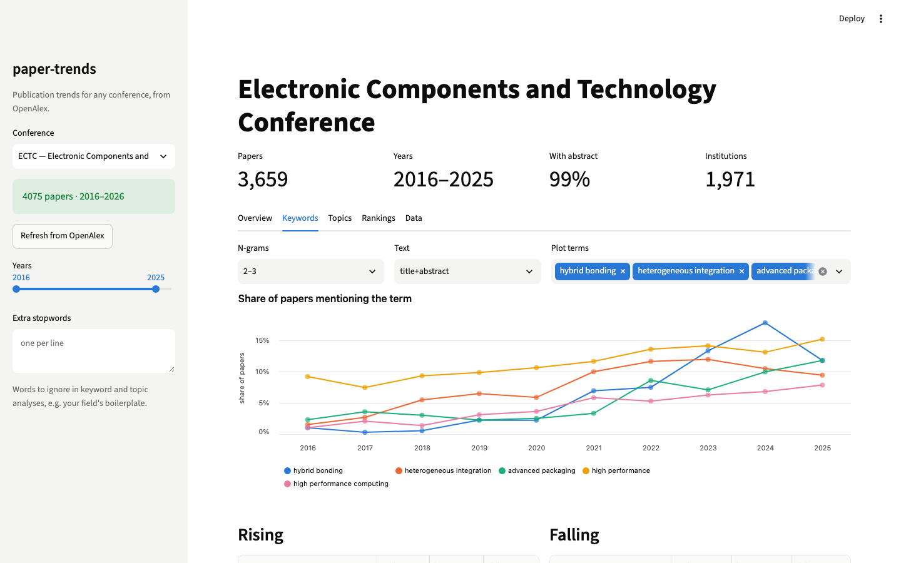
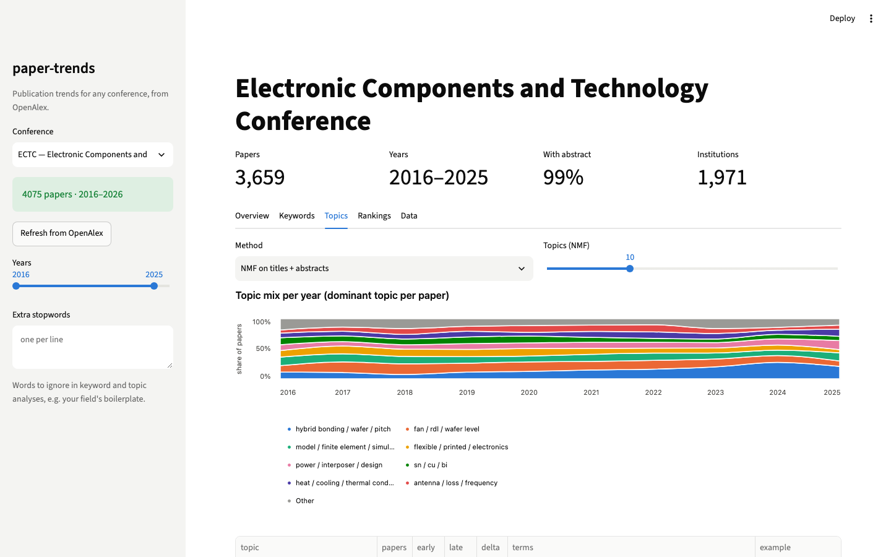

# paper-trends

Publication-trend analysis for **any academic conference**, built on the free, CC0-licensed
[OpenAlex](https://openalex.org) API.

Give it a conference name and it fetches every paper the venue has published, then
reports keyword trends, topic evolution, and institution / author / country rankings.

First showcase: **ECTC (IEEE Electronic Components and Technology Conference), 2016–2026**.
The same command works for ISSCC, IEDM, or any other venue indexed by OpenAlex.

> Status: early but usable. Command-line tools for fetching and analysis, plus a Streamlit app.



## Requirements

- Python 3.12+ (dependencies: requests, python-dotenv, scikit-learn, pandas, streamlit, altair)
- [uv](https://docs.astral.sh/uv/) for dependency management
- A contact email and (recommended) a free [OpenAlex API key](https://help.openalex.org/api/authentication/)

## Setup

```bash
git clone <this-repo>
cd paper-trends
uv sync

# OpenAlex asks for a contact address on every request. Put yours in .env (git-ignored):
echo "OPENALEX_MAILTO=you@example.com" > .env
# Strongly recommended: a free OpenAlex API key. Without one, requests draw on a small
# daily budget shared by everyone behind your IP address (VPNs and office networks burn
# through it fast). Keys: https://help.openalex.org/api/authentication/
echo "OPENALEX_API_KEY=your_key" >> .env
```

## Usage

### Interactive app

```bash
uv run streamlit run app.py
```

Pick a preset in the sidebar or type any conference name, fetch it once, then explore
keyword trends, topic evolution and institution / country rankings with a year-range
filter. Fetched data is cached under `data/`.

Presets (2016 onwards): **packaging** — ECTC, EPTC, ITherm, IRPS, EuroSimE;
**devices & circuits** — IEDM, ISSCC, VLSI Symposium, IMW. Each one is a conference
name plus the DOI prefix(es) its papers carry, so anything indexed by OpenAlex can be
added the same way.



To host it (e.g. on Streamlit Community Cloud) set `OPENALEX_MAILTO` and `OPENALEX_API_KEY` in
the app's secrets; the app reads them from `st.secrets` when the environment variables are absent.

### Fetch a conference (CLI)

```bash
uv run python -m paper_trends fetch "Electronic Components and Technology Conference" \
    --doi-prefix 10.1109/ectc --years 2016-2026 --name ectc
```

This writes one paper per line to `data/ectc.jsonl` and prints a per-year coverage table:

```
  year   papers  abstracts  coverage
-------------------------------------
  2016      391        388    99.2%
  2017      336        332    98.8%
  ...
  2025      382        380    99.5%
  2026      416         11     2.6%   <- OpenAlex has not indexed most 2026 abstracts yet
-------------------------------------
   all     4071       3646    89.6%
```

Each record contains: `id`, `doi`, `title`, `publication_year`, `abstract` (plain text),
`authorships` (authors, institutions, countries, raw affiliation strings),
`cited_by_count`, `source_id`, `source_name`.

### Keyword trends

```bash
uv run python -m paper_trends keywords data/ectc.jsonl --years 2016-2025 --ngram 2-3 --csv data/ectc_keywords.csv
```

Reports, for each term, the share of papers per year that mention it, plus the fastest
rising and falling terms (early half vs. late half of the range). ECTC 2016–2025, phrases only:

```
RISING                       early    late   delta      FALLING                    early    late   delta
hybrid bonding                1.3%   11.5%  +10.3%      wafer level                  14.4%    9.2%   -5.1%
heterogeneous integration     4.3%   10.7%   +6.4%      low cost                      7.9%    3.6%   -4.3%
advanced packaging            2.7%    8.2%   +5.5%      fan out wafer                 6.9%    4.0%   -2.8%
high performance              9.3%   13.5%   +4.2%      electrical performance        6.0%    3.5%   -2.6%
high performance computing    2.2%    6.4%   +4.2%      flip chip                     9.9%    7.4%   -2.5%
cu cu                         1.9%    5.8%   +3.9%      wafer level packaging         6.3%    3.9%   -2.4%
```

Options: `--ngram 1-3` (default), `--text title` to ignore abstracts, `--top N`, `--movers N`,
`--min-total N`, `--stopwords file` for domain-specific noise words, `--keep-subphrases`.

### Topic evolution

```bash
uv run python -m paper_trends topics data/ectc.jsonl --years 2016-2025 --n-topics 10
```

Fits an NMF topic model on titles + abstracts (reproducible, no external models), assigns
each paper to its dominant topic and shows the topic mix per year with example papers:

```
topic                                  papers    16    17    18    19    20    21    22    23    24    25   delta
hybrid bonding / wafer / cu cu            517   10%    9%    7%   10%   12%   14%   16%   19%   26%   18%   +9.1%
model / reliability / stress              505   17%   16%   17%   13%   13%   14%   13%   13%   11%   11%   -3.0%
fan / wafer level / fowlp                 394    9%   16%   15%   14%   13%   11%   10%    9%    7%    5%   -4.7%
dielectric / glass / layer                392   11%    9%   12%   10%   10%   11%   11%    9%   10%   14%   +0.7%
heat / cooling / temperature              371    9%   10%    9%   11%    8%   11%   12%   11%    7%   14%   +1.5%
power / design / interposer               360   11%    7%    6%   10%    8%   10%   10%   10%   11%   16%   +2.9%
sn / joint / solder joints                346   13%   10%    9%   13%   12%    8%    6%    7%    9%    7%   -4.0%
```

`--method openalex` uses OpenAlex's own topic labels instead (coarser, but no fitting).

### Institution, author and country rankings

```bash
uv run python -m paper_trends rank data/ectc.jsonl --years 2016-2025 --by institution --top 20
uv run python -m paper_trends rank data/ectc.jsonl --years 2016-2025 --by country
uv run python -m paper_trends rank data/ectc.jsonl --years 2016-2025 --by author --sort citations
```

Papers and summed citations per entity, a per-year breakdown, and which institutions or
countries are gaining or losing share. A paper counts once per institution (full counting).
Institution names and ids come from OpenAlex's affiliation matching, which is good but not
perfect; treat close ranks as ties.

### Another venue

```bash
uv run python -m paper_trends fetch "International Solid-State Circuits Conference" \
    --years 2016-2026 --name isscc
```

Check the `[sources]` lines printed first to confirm only the intended venue matched.

### Options

| Flag | Meaning |
|---|---|
| `query` | Conference name, matched against OpenAlex source names (case/punctuation-insensitive) |
| `--years 2016-2026` | Restrict to a year or year range |
| `--doi-prefix 10.1109/ectc` | Also include works whose DOI starts with this prefix (repeatable, see below) |
| `--source S123` | Use an explicit OpenAlex source ID instead of name search (repeatable) |
| `--name ectc` | Output file slug, `data/<name>.jsonl` |
| `--out path.jsonl` | Explicit output path |

**Why `--doi-prefix`?** Some venues are incomplete in OpenAlex's `sources` index. ECTC, for
example, has a proper source record for only one year; other years carry the conference
name on the paper but not as a filterable source. IEEE DOIs embed the venue acronym
(`10.1109/ECTC...`), so a DOI-prefix filter recovers them. Results from both routes are
merged and de-duplicated. The prefix must be followed by the conference number and a
dot, so `10.1109/isca` does not pull in ISCAS papers, and a venue whose prefix changed over
the years (VLSI Symposium has used ten) takes several `--doi-prefix` flags.

## Roadmap

- [x] `fetch`: pull all works of a conference into JSONL with coverage report
- [x] `keywords`: keyword / n-gram trends by year, rising and falling terms
- [x] `topics`: topic evolution over time (NMF or OpenAlex labels)
- [x] `rank`: institution / author / country rankings with citations
- [x] Streamlit app
- [ ] Hosted demo with pre-fetched presets
- [ ] Static HTML report

## Data & license

Metadata comes from [OpenAlex](https://openalex.org) (CC0). Only public data and public
methods are used. Code is released under the MIT License.
