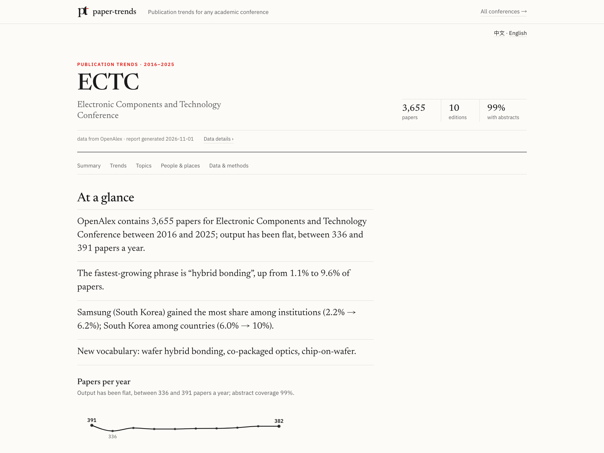
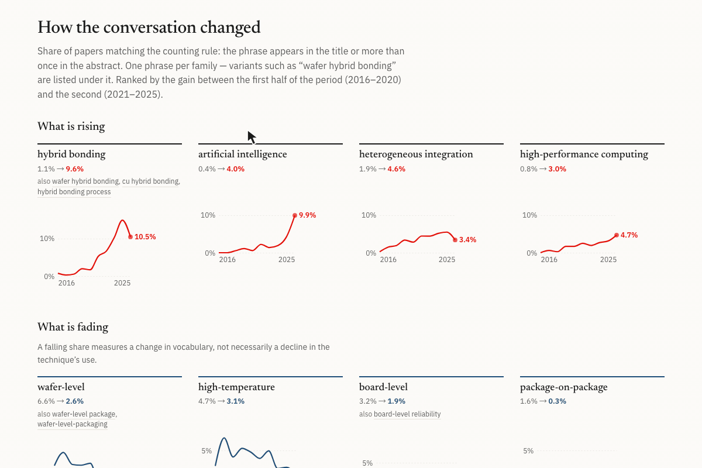
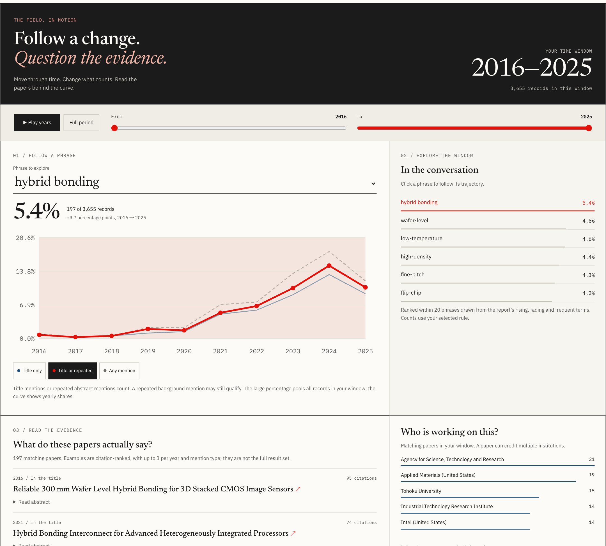
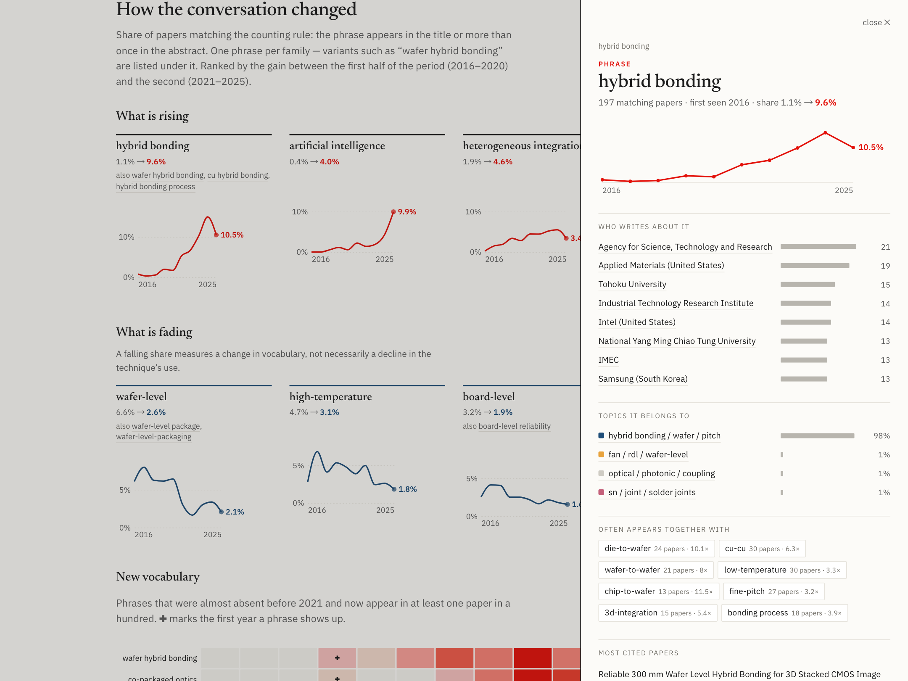
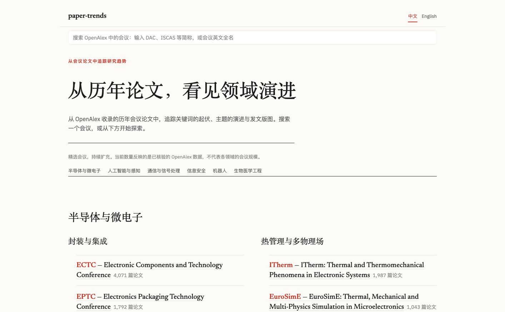
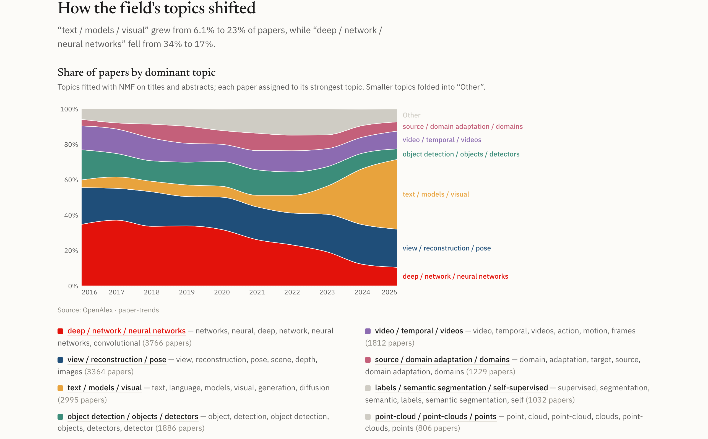

# paper-trends

**English** | [简体中文](README.zh-CN.md)

**[Try the live demo →](https://minjia-hu.github.io/paper-trends/)** ECTC and CVPR reports, 2016–2025. No setup or API key needed to view; full Explore is available in the local app.

[](https://github.com/Minjia-Hu/paper-trends/actions/workflows/ci.yml)
[](LICENSE)
[](pyproject.toml)

Publication-trend analysis for **any academic conference**, built on the free, CC0-licensed
[OpenAlex](https://openalex.org) API.

Give it a conference name and it retrieves matching paper metadata from OpenAlex, then
reports keyword trends, topic evolution, and institution / author / country rankings.

First showcase: **ECTC (IEEE Electronic Components and Technology Conference), 2016–2026**.
The same command works for ISSCC, IEDM, or any other venue indexed by OpenAlex.

> Status: early but usable. Command-line tools for fetching and analysis, a static report generator, and a Streamlit app.

Release notes: [Changelog](CHANGELOG.md).



Screenshots and the GIF show an earlier interface snapshot; figures and topic labels may differ from the current live demo.

## Requirements

- Python 3.12+ (dependencies: requests, python-dotenv, scikit-learn, pandas, streamlit, altair, jinja2)
- [uv](https://docs.astral.sh/uv/) for dependency management
- A contact email and a free, activated [OpenAlex API key](https://help.openalex.org/api/authentication/) for complete fetches

## Setup

```bash
git clone https://github.com/Minjia-Hu/paper-trends.git
cd paper-trends
uv sync

# Create your local configuration without overwriting an existing .env:
cp -n .env.example .env
# Edit .env: replace OPENALEX_MAILTO with your contact email and fill in OPENALEX_API_KEY.
# Get and activate a free key: https://help.openalex.org/api/authentication/
```

OpenAlex requires an API key for cursor paging beyond the first page, so complete
conference fetches need one. Anonymous queries also share a small daily budget with
everyone behind your IP address. The client uses the supported maximum of 100 results
per page; see [OpenAlex's paging rules](https://help.openalex.org/api/paging/).

Run CLI commands from the cloned repository with `uv run python -m paper_trends`.
The local setup deliberately uses `package = false` to avoid an editable-install
issue on some macOS systems; `uv sync` therefore does not install the `paper-trends`
console command into this environment. Run the app separately with
`uv run streamlit run app.py`; `app.py` belongs to the repository checkout.

## Quick start

```bash
# 1. find the venue — an acronym or a name; prints the OpenAlex name, DOI prefix and paper count
uv run python -m paper_trends resolve ECTC

# 2. fetch it (one to fifteen minutes depending on size; data/ectc.jsonl, git-ignored)
uv run python -m paper_trends fetch "Electronic Components and Technology Conference" \
    --doi-prefix 10.1109/ectc --years 2016-2025 --name ectc

# 3. a report page, and/or the app
uv run python -m paper_trends report data/ectc.jsonl --name "Electronic Components and Technology Conference" --years 2016-2025 --out site
open site/ectc.html
uv run streamlit run app.py
```

The app supports **中文 / English** in the page header. It follows the browser's
preferred language by default; use `?conference=ectc&lang=zh` for a shareable Chinese
report. Narrative, controls and chart tooltips are translated; paper titles,
abstracts, technical phrases and institution names stay in their original language.
Both languages share the same analysis. Static report generation also writes
`*.zh.html` and `index.zh.html` alongside the English pages.

Or skip the command line: `uv run streamlit run app.py`, pick a preset or type a venue,
and press **Fetch**.

## Usage

ECTC and CVPR figures in the text were checked against corpora fetched on 2026-11-01. Other conferences and historical audits retain their earlier snapshots; cross-conference examples combine refreshed ECTC with the existing IEDM and ISSCC corpora. Results can change with the OpenAlex index and analysis rules.

### Report pages

```bash
uv run python -m paper_trends report data/ectc.jsonl --name "Electronic Components and Technology Conference" --years 2016-2025 --out site
open site/ectc.html
```

Renders one concise static page per conference in an editorial layout: a few sentences
at a glance, four leading rising and fading phrases, new vocabulary, topic evolution,
and publishing geography with institution and country rankings. Method details and the
remaining topic labels stay available without occupying the main reading path. Pass
several corpora to get a linked set with an index page. The pages are plain HTML + CSS
with Vega-Lite charts, so they can be hosted anywhere static.

Everything named on a page is a link into it: click a phrase, an institution bar or a
topic band and a panel opens with its trend, who writes about it, which topics it belongs
to, what it co-occurs with and the most cited papers (DOI links). Names inside the panel
are clickable too, so you can walk from *hybrid bonding* to the institutions behind it to
their other signature phrases, with a back button and a trail. The panel data is
precomputed and inlined, so entity details need no server request. Reports contain
the linked-panel data, but omit the larger Explore evidence workspace. Vega charts
and fonts load from CDNs and require network access on first load.

### Interactive app

Follow a phrase to its institutions and their signature research: click **hybrid bonding**,
then an institution in the detail panel. The breadcrumb keeps the path visible.



```bash
uv run streamlit run app.py
```

Pick a conference from the home page, or type an acronym or name into the search box —
“ECTC”, “ISCAS”, “Custom Integrated Circuits Conference” — and the app resolves it against
OpenAlex (name, DOI prefix, paper count, and a warning when a prefix is shared by several
venues) before you fetch. **Report** is a concise, conclusion-first briefing for the
selected period: summary, leading phrase changes, topic mix, and publishing geography.
**Explore** is the working surface: change time and counting rules, inspect supporting
papers, analyse any two- or three-word phrase, study topics and institutions, compare
conferences, and export filtered papers. Explore starts with the report's period and
counting rule; its filters apply to the curve, evidence and CSV together. Fetched data is cached under `data/`; a DOI prefix for a custom venue and extra
stopwords live under **Options**.

The default report period is the last ten years ending before the current calendar
year. It also skips trailing years with fewer than 20% of the preceding three observed
editions' typical paper count, or delayed abstracts at a venue that normally has them.
This is a conservative heuristic, not proof that OpenAlex's coverage is complete.
**All** / **Custom** include the excluded years. Venues with consistently few abstracts
retain their historical years and use titles for phrase analysis. The CLI report uses
the same default when `--years` is omitted; explicit ranges override it.

Empty periods display an explanation. Single-year reports show counts and topic mix
without claims of growth or decline; topics are omitted if there is too little usable
text. Phrase detail panels use the same text and counting settings as the report, and
every phrase or variant displayed in its trend lists has a panel. The report date is
the generation date, not the date its cached data was fetched.

Reports also show **Data fetched**, separately from the report date. New CLI/app fetches
save a UTC completion timestamp in `<corpus>.jsonl.meta.json`, bound to the corpus bytes
by SHA-256. Missing, malformed or mismatched provenance displays **unknown**; copying or
editing a file does not invent a new fetch date. Keep the sidecar when moving a corpus.

Corpus and metadata files are each written to a temporary file and atomically replaced.
Readers see a complete corpus; between the two replacements, a mismatched checksum
reports an unknown fetch date.

Report and Explore share the cached keyword, topic and institution analysis for the same
corpus and settings. Searching for another phrase queries the stored tokens and adds its
evidence to Explore; it does not refit the topic model. The app retains at most four
shared fitted analyses. If a new report or phrase request needs an analysis that has
been evicted, the app computes it again.

The report explains excluded current/future editions, unusually sparse trailing editions
and delayed abstracts. Selected years with no cached records remain visible in the
coverage table. Abstract coverage below 90% is called out by year; below 60% overall,
phrase trends use titles only (topics still use available titles and abstracts).
These checks describe the local OpenAlex snapshot, not completeness against official
proceedings. See [coverage and freshness behavior (Chinese)](docs/data-coverage.md).

The **Trends & evidence** section in Explore starts with a field observatory. It lets you
play or select a time window and switch between title mentions,
title-or-repeated mentions, and any mention. The phrase curve, matching-paper counts,
phrase shortlist, institutions, topics, paper examples and complete evidence listing update
together without a server request. Open an example's abstract or follow its DOI to inspect
the evidence. Expand **All matching papers & export** to page through all matches or export
them as CSV. Report phrases link into Explore with the selected period and phrase preserved,
including custom year ranges.
All CSV exports (CLI, app downloads and Explore) prefix formula-like text cells with an
apostrophe so spreadsheet software treats them as text.

Counts cover every matching record; examples contain at most three highest-cited papers
per phrase/year/mention role. The shortlist contains up to 20 rising, fading, emerging
and frequent phrases. **Find another phrase** adds a typed phrase to this same workspace;
hyphenated display names resolve to their counting keys, and rare phrases remain searchable.
**More institution analysis** restores rank history and institution/topic profiles on demand,
respecting parent roll-up. Title-only corpora disable abstract rules. See
[interactive exploration behavior and tests (Chinese)](docs/interactive-report.md).



Clicking a report phrase opens its linked detail panel with related institutions, topics
and co-occurring phrases:



The home page presents a curated set of reports in two levels. **Semiconductor &
microelectronics** is split into packaging & integration (ECTC, EPTC, ICEPT), thermal
management & multiphysics (ITherm, EuroSimE), reliability (IRPS), and devices & circuits
(IEDM, ISSCC, VLSI Symposium, IMW). **Artificial intelligence & perception** contains
computer vision (CVPR) and speech technology (Interspeech); **communications & signal
processing** contains signal processing (ICASSP) and communications & networking
(GLOBECOM, INFOCOM). **Information security** (IEEE S&P), **robotics** (ICRA), and
**biomedical engineering** (EMBC) are specific enough to list their venues directly.
Domain headings now occupy their own sections, so research directions cannot be mistaken
for peer domains. The number shown in each group reflects verified OpenAlex coverage, not
the real-world number of conferences in that field. Each preset is a conference name plus
the DOI prefix(es) its papers carry, so any venue indexed by OpenAlex can be added the same
way, or simply typed into the search box.

Coverage varies by venue and year; a successful name match is not proof of a complete
corpus. The [candidate venue audit (Chinese)](docs/venue-audit-2026-10-05.md) records prefix
collisions, changing prefixes, and gaps found before expanding the presets.

The cross-field additions have cached corpora and report pages. GLOBECOM uses both
`10.1109/glocom` (early years) and `10.1109/globecom`; IEEE S&P uses `10.1109/sp` with
the DOI boundary check that excludes unrelated conferences and workshops. Search
`S&P`, `IEEE S&P`, `IEEE SP` or `sp` to open the same security preset. INFOCOM defaults
to 2016–2024 because its 2025 records are still sparse; 2026 remains visible under an
explicit period selection but is excluded from the default trend window.

<details>
<summary>View the home page: conference search and field groups</summary>



</details>

To host it (e.g. on Streamlit Community Cloud) set `OPENALEX_MAILTO` and `OPENALEX_API_KEY` in
the app's secrets; the app reads them from `st.secrets` when the environment variables are absent.

### Fetch a conference (CLI)

```bash
uv run python -m paper_trends fetch "Electronic Components and Technology Conference" \
    --doi-prefix 10.1109/ectc --years 2016-2026 --name ectc
```

This writes one paper per line to `data/ectc.jsonl`, records fetch provenance in
`data/ectc.jsonl.meta.json`, and prints a per-year coverage table:

```
  year   papers  abstracts  coverage
-------------------------------------
  2016      393        389    99.0%
  2017      337        332    98.5%
  ...
  2025      382        380    99.5%
  2026      417          8     1.9%   <- OpenAlex has not indexed most 2026 abstracts yet
-------------------------------------
   all     4075       3643    89.4%
```

Each record contains: `id`, `doi`, `title`, `publication_year`, `abstract` (plain text),
`authorships` (authors, institutions, countries, raw affiliation strings),
`cited_by_count`, `source_id`, `source_name`.

Fetches deduplicate OpenAlex IDs and DOIs. If several IDs share a DOI, one record is
kept, preferring usable text and authorship metadata, then the higher citation count;
citations are not added across duplicates. Records without a DOI are not merged by
title alone. Proceedings front matter and identifiable textless catalog entries are
excluded.

Parent-institution enrichment is best effort. If its API lookup fails after the
papers have been retrieved, the fetch retains the paper records and original
affiliations, prints a warning, and marks unresolved parents in the corpus.
Rankings fall back to the direct institution for those affiliations.

### Keyword trends

```bash
uv run python -m paper_trends keywords data/ectc.jsonl --years 2016-2025 --ngram 2-3 --csv data/ectc_keywords.csv
```

Phrases are word sequences from titles and abstracts (OpenAlex has no full text). A few
rules keep the lists about the conference rather than about academic prose:

- **A paper counts when the phrase is in its title or repeated in its abstract**, after
  acronym normalization. This is a relevance heuristic, not a topic label: repeated
  background or application mentions can still count. `uv run python -m paper_trends validate` compares
  abstract roles with title mentions; it is not a ground-truth accuracy benchmark.
  `--count any` counts every mention instead.
- **Acronyms are read as their phrase.** When the corpus defines one (“redistribution
  layer (RDL)”), later *RDL*s count as repeats; a long form that cannot be a phrase
  (*through-silicon via*, *fan-out wafer-level packaging*) is folded into the acronym
  instead (*TSV*, *FOWLP*).
  Definitions in the paper override the corpus majority. Undefined uses can still be
  ambiguous. Plurals retain case evidence: *loss* is not treated as plural *LoS*, while
  explicitly written *LoSs* and *MBSs* still fold. Lower-case `ss` endings are not guessed.
- **Fragments are folded into the phrase they belong to**: *level packaging* only ever
  occurs inside *wafer-level packaging* and *panel-level packaging*, *scanning electron*
  inside *scanning electron microscopy*. `--keep-subphrases` shows them.
- **One phrase per family** in the rising, falling and emerging lists: *wafer hybrid
  bonding* and *hybrid bonding process* are listed under *hybrid bonding* rather than
  taking three slots.
- **Reviewed boilerplate phrases are hidden only with cross-field evidence**: exact
  phrases in `background.BOILERPLATE` (*high performance*, *low cost*, *next generation*…)
  must also appear in at least 1% of papers in three other fields. Cross-field technical
  phrases (*deep learning*, *neural networks*, *energy consumption*) remain eligible;
  *high performance computing* does not inherit the exclusion of *high performance*.
  `--keep-common` restores boilerplate. `uv run python -m paper_trends background data/*.jsonl` rebuilds
  the frequency table; it does not change the reviewed phrase list.

See [the five-conference trend audit (Chinese)](docs/trend-audit-2026-10-05.md) for count checks,
filter changes, paper examples and known acronym limitations.

ECTC 2016–2025, share of papers, first vs. second half of the period:

```
RISING                       early    late   delta      FALLING                      early    late   delta
hybrid bonding                1.1%    9.6%   +8.6%      wafer-level                   6.6%    2.6%   -3.9%
heterogeneous integration     1.9%    4.6%   +2.7%      board-level                   3.2%    1.9%   -1.3%
cu-cu                         1.3%    3.5%   +2.2%      package-on-package            1.6%    0.3%   -1.2%
advanced packaging            1.4%    3.5%   +2.1%      flip-chip                     4.8%    3.6%   -1.2%
co-packaged optics            0.1%    1.7%   +1.7%      ultra-thin                    2.2%    1.0%   -1.2%
wafer-to-wafer                0.6%    2.1%   +1.4%      radio-frequency               3.8%    2.8%   -1.0%
```

These are statistical heuristics, not a validated taxonomy.
`uv run python -m paper_trends validate data/ectc.jsonl` prints the one check the data
supports on its own — how often a phrase with each kind of mention also appears in
the title. The historical ECTC check recorded repeated 32 %, once in the opening
21 %, and once later 7 %. These are historical measurements, not a fresh result for
the current corpus or tokenizer; rerun the command to assess a rule change.

### Topic evolution

```bash
uv run python -m paper_trends topics data/ectc.jsonl --years 2016-2025 --n-topics 10
```

Fits an NMF topic model on titles + abstracts (reproducible, no external models), assigns
each paper to its dominant topic and shows the topic mix per year with example papers:

```
topic                                        papers    16    17    18    19    20    21    22    23    24    25   delta
hybrid bonding / wafer / pitch                  574   12%   11%    8%   12%   12%   15%   16%   20%   28%   21%   +9.1%
fan / rdl / wafer level                         490   10%   17%   18%   15%   15%   14%   14%   12%   11%    9%   -3.0%
model / finite element / simulation             418   14%   13%   11%   10%   10%   12%   11%   10%    9%   13%   -0.4%
power / interposer / design                     361   10%    7%    7%   10%    9%   11%   10%    9%   10%   15%   +2.3%
flexible / printed / electronics                357   11%   12%   12%   12%   12%   10%    8%    8%    8%    5%   -3.9%
heat / power / temperature                      353    9%   10%    9%   10%    7%   11%   11%   10%    7%   12%   +1.2%
antenna / loss / frequency                      309    5%    7%   10%    8%   12%   10%   12%    9%    5%    7%   +0.2%
```

`--method openalex` uses OpenAlex's own topic labels instead (coarser, but no fitting).

### Institution, author and country rankings

```bash
uv run python -m paper_trends rank data/ectc.jsonl --years 2016-2025 --by institution --top 20
uv run python -m paper_trends rank data/ectc.jsonl --years 2016-2025 --by country
uv run python -m paper_trends rank data/ectc.jsonl --years 2016-2025 --by author --sort citations
```

Papers and summed citations per entity, a per-year breakdown, and which institutions or
countries are gaining or losing share. The report page and the app also draw a world map
of the share of papers by country (single-hue, square-root scale so the leading country
does not wash out the rest). A paper counts once per institution (full counting).
`--roll-up` credits top-level parents from OpenAlex's institution lineage (A*STAR rather
than its IME institute, Chinese Academy of Sciences rather than each institute), which is
what the app shows by default; occasionally that merges too much (ETH Zurich and EPFL share
an umbrella board), so the app has a toggle. Institution ids come from OpenAlex's affiliation matching,
which is good but not perfect; treat close ranks as ties.

### Compare conferences

```bash
uv run python -m paper_trends compare data/ectc.jsonl data/iedm.jsonl data/isscc.jsonl --years 2016-2025 --ngram 2-3
uv run python -m paper_trends compare data/ectc.jsonl data/iedm.jsonl --term "hybrid bonding" --term chiplet
```

Without `--term` it lists phrases rising in *every* corpus. Here phrases common to many
fields are kept, since what venues share is the point. Packaging (ECTC), devices (IEDM)
and circuits (ISSCC), 2016–2025:

```
term                          ectc       iedm      isscc
artificial intelligence      +3.6%      +4.5%      +4.3%
high density                 +1.4%      +1.1%      +0.4%
high performance             +2.2%      +0.2%      +0.3%
power delivery               +0.9%      +0.2%      +0.6%
large scale                  +0.4%      +0.2%      +0.6%

artificial intelligence
         2016   2017   2018   2019   2020   2021   2022   2023   2024   2025
ectc     0.0%   0.0%   0.5%   1.1%   0.6%   2.2%   1.4%   1.9%   4.2%   9.9%
iedm     0.0%   0.0%   0.9%   1.2%   1.7%   2.7%   2.2%   4.8%   6.5%   8.7%
isscc    0.5%   0.0%   1.4%   2.4%   3.2%   4.2%   5.5%   6.1%   6.0%   7.0%
```

*Artificial intelligence* includes expanded *AI* mentions. The counts show increasing
use of the vocabulary in these corpora, but cannot distinguish AI methods from AI-driven
hardware applications or repeated background mentions. Inspect the backing papers before
interpreting a phrase as the paper's research subject.

In Explore, **Compare conferences** plots the same terms across fetched conferences,
and **Trends & evidence** lists the papers behind a phrase. CLI `--term` searches use
the same hyphen and acronym normalization as Explore. Years with no cached papers are
shown as missing values rather than zero-percent shares.

### Resolve an acronym

```bash
uv run python -m paper_trends resolve ECTC
# name:         Electronic Components and Technology Conference
# doi prefixes: 10.1109/ectc
# Paper counts depend on the current OpenAlex snapshot.
```

Acronyms are tried as IEEE-style DOI prefixes and the name is read off the matching
papers; full names are matched against OpenAlex sources and a prefix is inferred. Prefixes
shared by several venues (`10.1109/iccad` is both Computer-Aided Design and Control,
Automation and Diagnosis) are flagged.

### Another venue

```bash
uv run python -m paper_trends fetch "International Solid-State Circuits Conference" \
    --years 2016-2026 --name isscc
```

Check the `[sources]` lines printed first to confirm only the intended venue matched.

### Not just semiconductors

The same pipeline on **CVPR 2016–2025** (16,877 papers, identifiable workshop records excluded, 99.7% with
abstracts) recovers the field's history without any vision-specific configuration.
The table below uses the corpus fetched on 2026-11-01 and eight NMF topics; the five
largest topics are shown. The screenshot retains an earlier interface snapshot:

```
topic                                        papers    16    17    18    19    20    21    22    23    24    25   delta
3d / view / pose                               3482   22%   19%   20%   19%   20%   20%   20%   23%   22%   21%   +1.4%
deep / network / neural networks               2611   26%   27%   25%   25%   23%   17%   16%   13%    8%    7%  -13.7%
visual / text / vision-language                2290    7%    8%    8%    7%    7%    8%    9%   13%   20%   26%   +9.1%
video / temporal / videos                      2023   16%   17%   14%   13%   12%   13%   13%   11%   10%   10%   -2.5%
generation / diffusion models / text           1809    0%    3%    6%    5%    6%    7%    6%    9%   19%   21%   +8.7%
```

In the same analysis, rising phrases include diffusion models, vision-language,
real-world and pre-trained. Falling phrases include neural networks, deep-learning,
person re-identification and convolutional networks.



**Interspeech 2016–2025** (9.7k papers, non-IEEE publisher, titles only because OpenAlex
lacks most of its abstracts): self-supervised, zero-shot, large language and
text-to-speech rise; recurrent neural networks, speaker recognition and acoustic models fall.

**ICRA 2016–2025** (11.7k papers, 98 % with abstracts): reinforcement learning (3.0 % →
6.7 % of papers), real-world, point clouds, autonomous driving and multi-agent rise;
convolutional neural networks and unmanned aerial vehicles fade; China's share of papers
goes from 8 % to 22 %.

### Data coverage, honestly

OpenAlex often has broad coverage for IEEE-style venues whose DOIs carry the acronym
(ECTC, ISSCC, IEDM, CVPR, ICRA, ...). Earlier snapshots had about 97 % abstract
availability for many of these venues. That describes cached records, not completeness
against official proceedings; coverage varies by venue and year. It is weaker elsewhere:

- **Interspeech** (`10.21437/interspeech`): broad paper coverage in earlier snapshots,
  but abstracts for only ~40 % —
  use `--text title`, titles alone still give clean trends.
- **NeurIPS, ICML, CHI**: no DOIs on most papers and patchy source records (NeurIPS
  stops in 2021), so they are not well served by OpenAlex yet.
- The most recent year usually lacks abstracts for a few months after the conference.

`fetch` prints a per-year coverage table so you can judge before analysing.

### Options

| Flag | Meaning |
|---|---|
| `query` | Conference name, matched against OpenAlex source names (case/punctuation-insensitive) |
| `--years 2016-2026` | Restrict to a year or year range |
| `--doi-prefix 10.1109/ectc` | Also include works whose DOI starts with this prefix (repeatable, see below) |
| `--source S123` | Use an explicit OpenAlex source ID instead of name search (repeatable) |
| `--name ectc` | Output file slug, `data/<name>.jsonl` |
| `--out path.jsonl` | Explicit output path |

**Why `--doi-prefix`?** Some venues are incomplete in OpenAlex's `sources` index. ECTC, for
example, has a proper source record for only one year; other years carry the conference
name on the paper but not as a filterable source. IEEE DOIs embed the venue acronym
(`10.1109/ECTC...`), so a DOI-prefix filter recovers them. Results from both routes are
merged and de-duplicated. The prefix must be followed by the conference number and a
dot, so `10.1109/isca` does not pull in ISCAS papers, and a venue whose prefix changed over
the years (VLSI Symposium has used ten) takes several `--doi-prefix` flags.

## How it works

1. **Resolve the venue.** OpenAlex `sources` are searched by name, preferring sources
   whose core name, stripped of year/publisher decoration, equals the query. Longer
   names may fall back to substring matching when no exact match exists; short
   acronyms use conservative exact-source or DOI-prefix matching. IEEE-style DOI
   prefixes (`10.1109/ectc`) are used as a second route, with a boundary check so
   `isca` never matches `iscas`. Front matter (title pages, session overviews,
   committees, "not made available for publication") is dropped.
2. **Count, don't weigh.** Every statistic is the share of that year's papers: papers
   about a phrase, a topic's dominant-paper count, an institution's papers (a paper
   counts once per institution). Shares make years and venues of different size
   comparable and are easy to sanity-check against the corpus. A paper is *about* a
   phrase when the phrase is in its title or mentioned more than once (acronyms the
   corpus defines count as the phrase). A phrase is left out of rankings only when it
   is reviewed boilerplate and occurs in at least 1% of papers in three other fields;
   cross-field technical phrases remain eligible.
3. **Rising / falling** = pooled share in the second half of the year range minus the
   first half, with a minimum-paper threshold. Fragments that almost always sit inside a
   longer phrase are folded into it, and the lists show one phrase per family.
4. **Topics** are NMF on TF-IDF of titles + abstracts with a fixed seed; labels are the
   top terms, phrases preferred. OpenAlex's own topic labels are available as an
   alternative but are too coarse for a single-field venue.

Limitations worth knowing: abstracts for the latest year arrive months after the
conference; OpenAlex institution matching occasionally maps a lab to a look-alike
entity; venues without DOIs are sparsely indexed; and the stopword list is generic, so
pass your field's boilerplate with `--stopwords` or under Options in the app. The two
phrase rules are heuristics chosen from the data, not validated against hand-labelled
papers; `--count any --keep-common` turns both off.

## Roadmap

- [x] `fetch`: pull all works of a conference into JSONL with coverage report
- [x] `keywords`: keyword / n-gram trends by year, rising and falling terms
- [x] `topics`: topic evolution over time (NMF or OpenAlex labels)
- [x] `rank`: institution / author / country rankings with citations
- [x] Streamlit app
- [x] Compare terms across conferences (CLI + Explore section)
- [x] Static report pages (`report`)
- [x] [Hosted example reports](https://minjia-hu.github.io/paper-trends/) for ECTC and CVPR (GitHub Pages)

## Development checks

```bash
uv sync --frozen
uv run ruff check .
uv run pytest -q

# Node.js 24 recommended (CI); DOM dependencies are pinned in package-lock.json.
npm ci --ignore-scripts
npm test
```

CI runs minimal Ruff correctness checks, the offline Python suite on Python 3.12 and 3.13, plus the Node core and
jsdom interaction tests on Node 24, including Explorer interactions and report entity
navigation. `npm test` fails if jsdom is missing, rather than
silently skipping the DOM suite. Historical audit documents under `docs/` retain the
results and corpus snapshots recorded when those audits were performed.
Dependabot checks Python, npm and GitHub Actions dependencies weekly and opens update pull requests for review.
An optional, manually triggered [live OpenAlex check](CONTRIBUTING.md#optional-live-api-check)
verifies fetching and report generation with real data.

## Data & license

Metadata comes from [OpenAlex](https://openalex.org) (CC0). Only public data and public
methods are used. Code is released under the MIT License.
