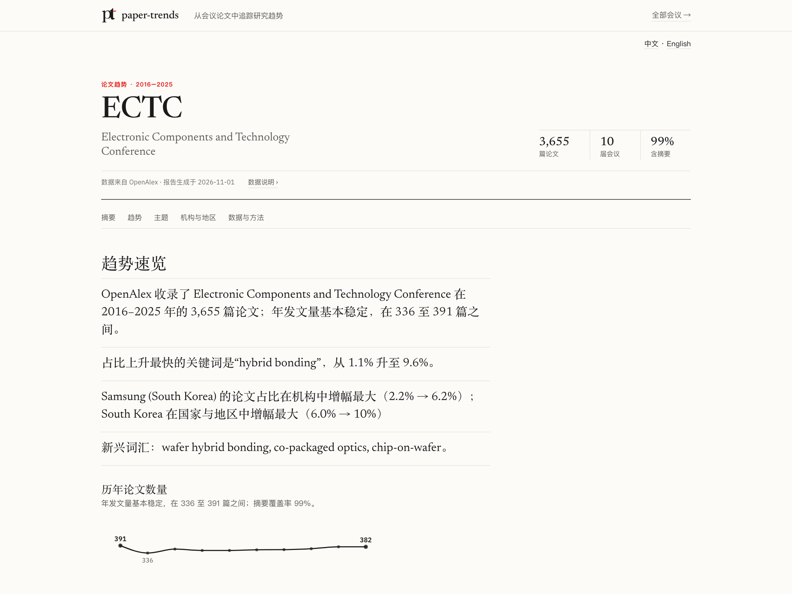
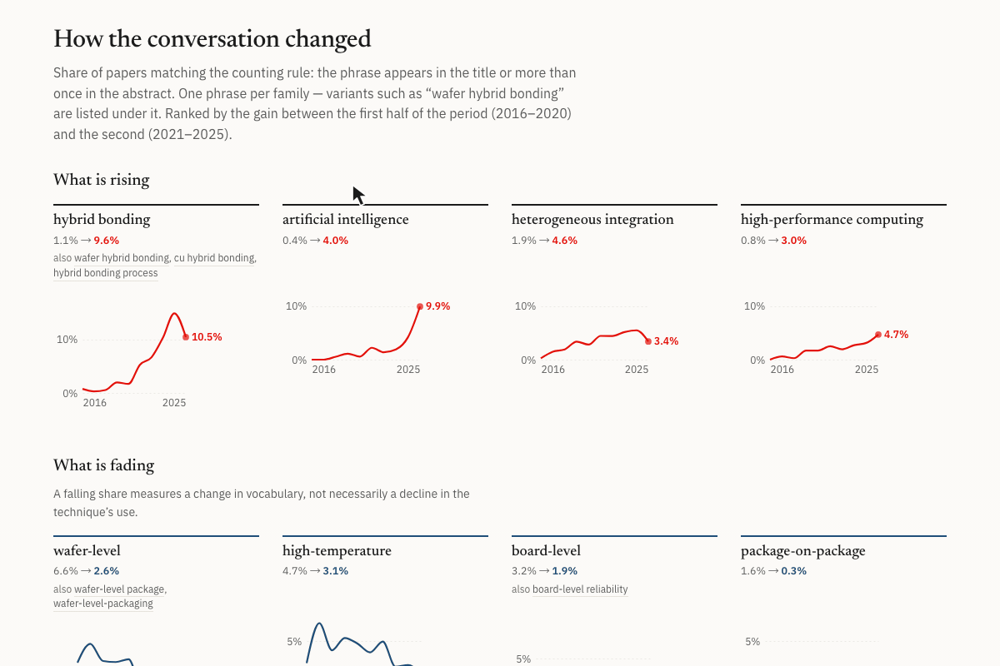
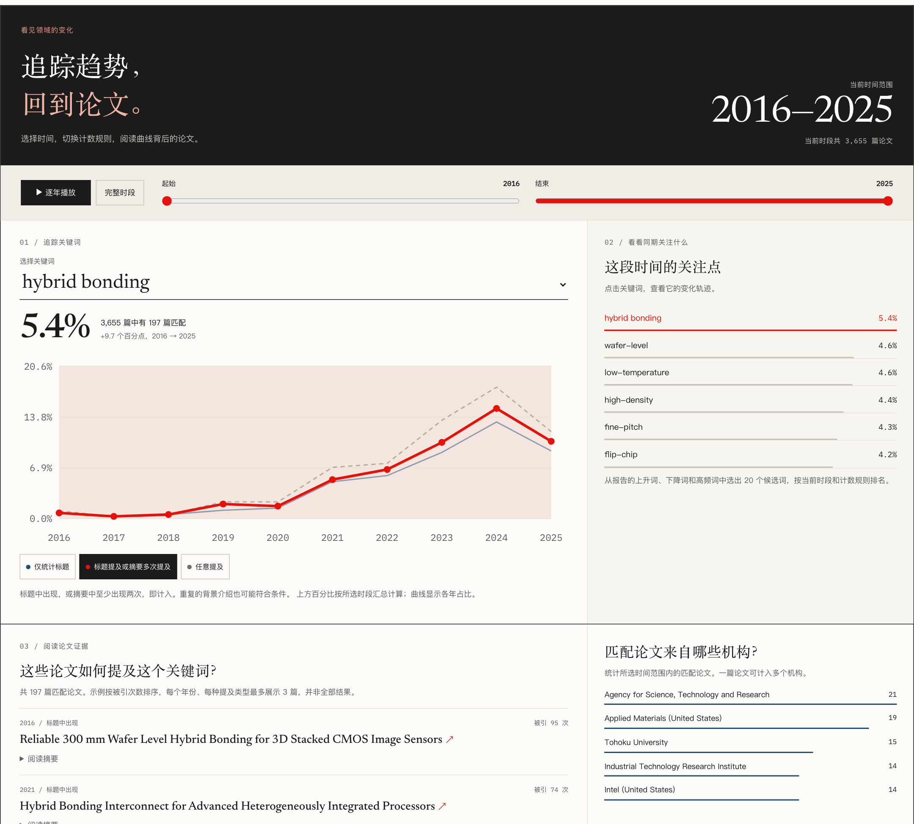
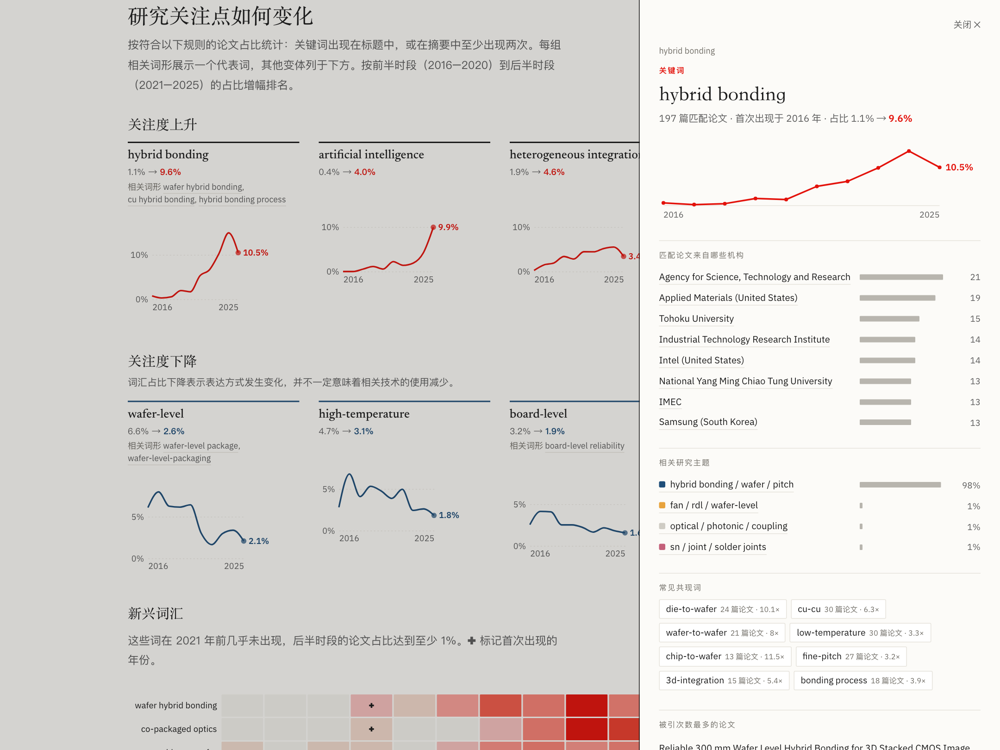
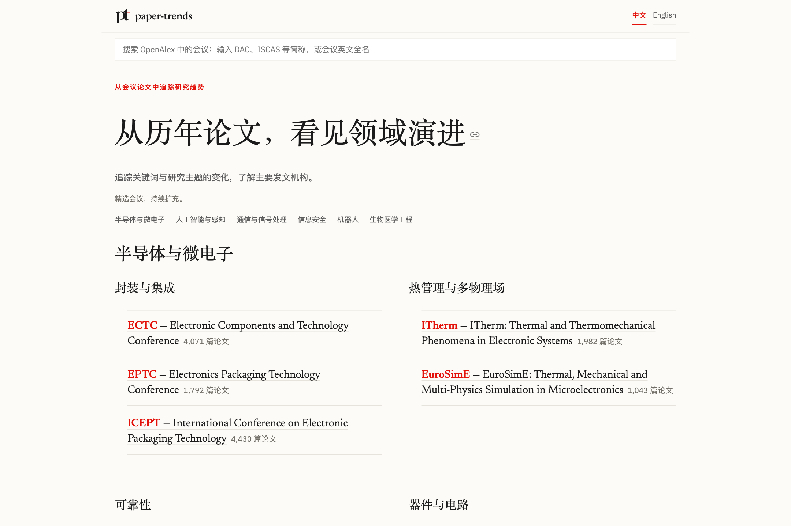
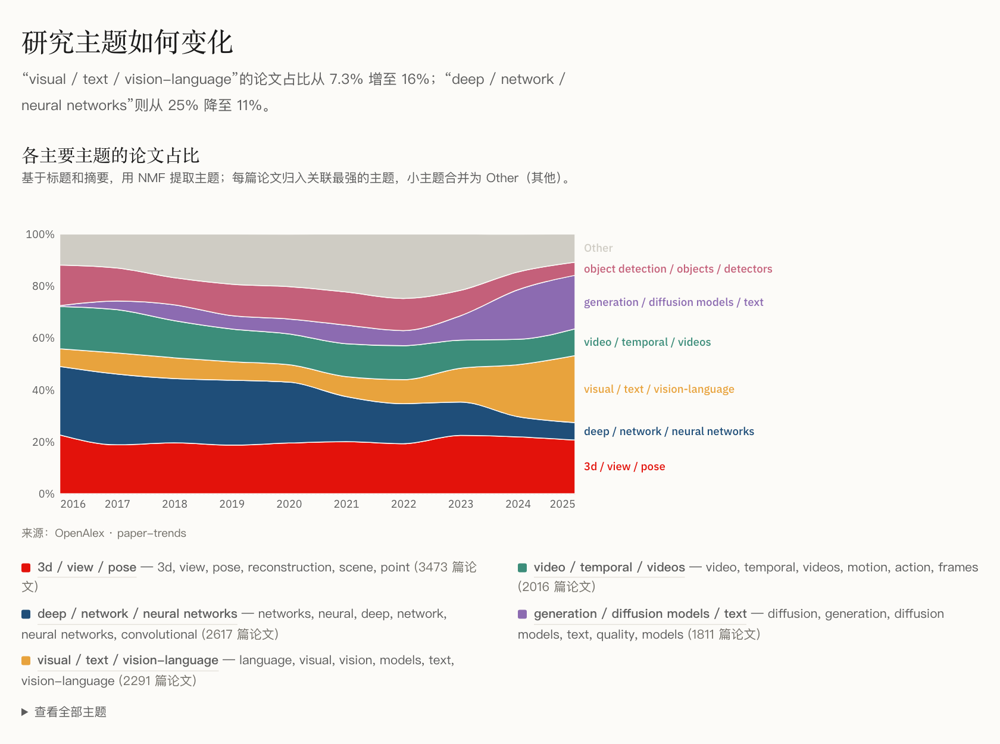

# paper-trends

[English](README.md) | **简体中文**

**[打开在线示例 →](https://minjia-hu.github.io/paper-trends/index.zh.html)** ECTC 与 CVPR 的 2016–2025 年报告，无需安装或配置 API key 即可查看；完整 Explore 请使用本地应用。

[](https://github.com/Minjia-Hu/paper-trends/actions/workflows/ci.yml)
[](LICENSE)
[](pyproject.toml)

面向**任意学术会议**的论文发表趋势分析工具，基于免费、采用 CC0 许可的 [OpenAlex](https://openalex.org) API。

输入会议名称，即可获取 OpenAlex 收录的相关论文元数据，分析关键词趋势、主题演变，以及机构、作者和国家排名。

首个展示案例：**ECTC（IEEE Electronic Components and Technology Conference，电子元件与技术大会），2016–2026 年**。
同样的命令也适用于 ISSCC、IEDM，以及其他被 OpenAlex 收录的会议。

> 项目状态：处于早期阶段，已可使用。提供数据获取与分析命令行工具、静态报告生成器，以及 Streamlit 交互应用。

版本记录：[更新日志](CHANGELOG.md)。



截图和 GIF 保留较早的界面快照，数值和主题标签可能与当前在线示例不同。

## 环境要求

- Python 3.12+（依赖 requests、python-dotenv、scikit-learn、pandas、streamlit、altair、jinja2）
- 用于管理依赖的 [uv](https://docs.astral.sh/uv/)
- 联系邮箱，以及完整抓取所需的已激活免费 [OpenAlex API key](https://help.openalex.org/api/authentication/)

## 安装与配置

```bash
git clone https://github.com/Minjia-Hu/paper-trends.git
cd paper-trends
uv sync

# 创建本地配置，不覆盖已有的 .env：
cp -n .env.example .env
# 编辑 .env：将 OPENALEX_MAILTO 替换为你的联系邮箱，并填写 OPENALEX_API_KEY。
# 获取并激活免费 key：https://help.openalex.org/api/authentication/
```

OpenAlex 的游标分页从第二页开始需要 API key，因此完整抓取会议论文必须配置 key。
匿名查询还会与同一 IP 地址下的用户共享少量每日额度。
客户端按受支持的上限每页获取 100 条记录，详见 [OpenAlex 分页规则](https://help.openalex.org/api/paging/)。

在克隆的仓库目录中，通过 `uv run python -m paper_trends` 运行命令行工具。
本地配置有意使用 `package = false`，以避开部分 macOS 环境中的可编辑安装问题；因此，
`uv sync` 不会在该环境中安装 `paper-trends` 命令。交互应用单独通过
`uv run streamlit run app.py` 启动，`app.py` 位于仓库根目录。

## 快速开始

```bash
# 1. 查找会议：输入缩写或名称，查看 OpenAlex 名称、DOI 前缀和论文数量
uv run python -m paper_trends resolve ECTC

# 2. 获取数据：视规模约需 1–15 分钟，写入 data/ectc.jsonl（已被 Git 忽略）
uv run python -m paper_trends fetch "Electronic Components and Technology Conference" \
    --doi-prefix 10.1109/ectc --years 2016-2025 --name ectc

# 3. 生成报告页面，或启动交互应用
uv run python -m paper_trends report data/ectc.jsonl --name "Electronic Components and Technology Conference" --years 2016-2025 --out site
open site/ectc.html
uv run streamlit run app.py
```

应用页头支持切换 **中文 / English**，默认跟随浏览器首选语言。
使用 `?conference=ectc&lang=zh` 可以分享中文版报告链接。报告说明、控件和图表提示会切换语言；
论文标题、摘要、技术短语和机构名称保留原文。两个语言版本使用相同的分析结果。
生成静态报告时，还会在英文页面之外生成 `*.zh.html` 和 `index.zh.html`。

也可以直接运行 `uv run streamlit run app.py`，选择预设会议或输入会议名称，再点击**获取**。

## 使用说明

ECTC 和 CVPR 的正文统计已按 2026-11-01 重新抓取的语料核对。其他会议及历史审查数字保留原快照；跨会议示例结合刷新后的 ECTC 与原有 IEDM、ISSCC 语料。结果会随 OpenAlex 索引和分析规则变化。

### 报告页面

```bash
uv run python -m paper_trends report data/ectc.jsonl --name "Electronic Components and Technology Conference" --years 2016-2025 --out site
open site/ectc.html
```

每个会议生成一份采用编辑式排版的简洁静态报告：先用几句话概述，再展示各四个主要上升、下降短语，
以及新出现的词汇、主题演变、机构与国家排名和论文发表的地理分布。
方法说明和其余主题标签仍可查看，但不会占据主要阅读区域。
传入多个语料文件时，会生成相互链接的报告和索引页。
页面采用纯 HTML、CSS 和 Vega-Lite 图表，可部署到静态网站托管平台。

页面上的短语、机构条形图和主题带均可点击，打开详情面板，查看趋势、相关机构、所属主题、
共现短语和高被引论文（附 DOI 链接）。面板内部的名称也可继续点击：例如从 *hybrid bonding*
追踪到相关机构，再查看这些机构的其他代表性短语，并通过返回按钮和路径导航回溯。
面板数据已预计算并内嵌到页面，查看详情无需请求服务器。
报告包含这些关联详情，但不包含体积更大的 Explore（探索）证据工作区。
Vega 图表库和字体通过 CDN 加载，首次加载需要网络连接。

### 交互应用

从短语追踪到相关机构及其特色研究：点击 **hybrid bonding**，再点击详情面板中的机构。
面包屑导航保留完整路径。下方为英文界面的操作演示，中英文界面均支持这些交互。



```bash
uv run streamlit run app.py
```

在首页选择会议，或在搜索框输入缩写、名称，例如“ECTC”“ISCAS”“Custom Integrated Circuits Conference”。
应用会先查询 OpenAlex，展示会议名称、DOI 前缀、论文数量；若多个会议共用前缀，也会给出警告。
**Report（报告）**提供所选时段的简明概览：总结、主要短语变化、主题构成和发表地理分布。
**Explore（探索）**用于进一步分析：调整时间范围和计数规则、查看支撑论文、分析任意两词或三词短语、
研究主题和机构、比较会议，以及导出筛选后的论文。
Explore 初始采用报告的时段与计数规则，筛选条件同步作用于曲线、证据和 CSV 导出。
获取的数据缓存在 `data/` 下；自定义会议的 DOI 前缀和额外停用词可在 **Options（选项）**中设置。

默认报告时段为当前年份之前的最近十年。此外，末尾年份的论文数若不足此前三个有记录年份典型数量的 20%，
或某会议通常有摘要、但末尾年份的摘要明显延迟，也会被跳过。
这是保守的启发式规则，不能证明 OpenAlex 的收录完整。
选择 **All（全部）**或 **Custom（自定义）**可包含被排除的年份。
对于长期缺少摘要的会议，保留历史年份，并使用标题分析短语。
CLI 报告在省略 `--years` 时采用相同默认规则；显式指定年份范围时则使用指定值。

空时段会显示原因说明。仅含单年的报告展示数量与主题构成，不作上升或下降判断；
可用文本过少时不展示主题。短语详情面板与报告采用相同的文本和计数设置，
趋势列表中显示的每个短语或变体均有对应面板。
报告日期指生成日期，不是缓存数据的获取日期。

报告单独展示**数据获取时间（Data fetched）**。新的 CLI 或应用抓取会将 UTC 完成时间保存到
`<corpus>.jsonl.meta.json`，并通过 SHA-256 将其绑定到语料文件的实际字节。
来源记录缺失、格式错误或与语料不匹配时显示**未知（unknown）**；复制或编辑文件不会被视为重新获取数据。
移动语料时，请同时保留该元数据文件。

语料和元数据各自先写入临时文件，再原子替换。读取者会看到完整的语料；
两次替换之间若校验和暂不一致，获取时间会显示为未知。

同一语料和设置下，Report 与 Explore 共用缓存的关键词、主题和机构分析。
搜索其他短语时，会查询已保存的词元并将证据加入 Explore，不会重新拟合主题模型。
应用最多保留四份共享的已拟合分析；新报告或短语查询需要已被淘汰的分析时，会重新计算。

报告会说明为何排除当前或未来届次、末尾异常稀疏的届次，以及摘要延迟的年份。
所选年份即使没有缓存记录，也仍会出现在覆盖率表中。
摘要覆盖率低于 90% 的年份会被标注；整体低于 60% 时，短语趋势仅使用标题，
主题分析仍使用可用的标题与摘要。这些检查描述本地 OpenAlex 快照的状况，
不能证明其相对于官方论文集的完整程度。详见[数据覆盖率与新鲜度说明](docs/data-coverage.md)。

Explore 中的 **Trends & evidence（趋势与证据）**提供领域观察视图。
可以播放或选择时间窗口，并切换“标题提及”“标题提及或重复提及”“任意提及”计数规则。
短语曲线、匹配论文数、短语候选列表、机构、主题、论文示例和完整证据列表会同步更新，无需请求服务器。
可以展开示例摘要，或通过 DOI 查看原始证据。
展开 **All matching papers & export（全部匹配论文与导出）**，可分页浏览所有匹配结果或导出 CSV。
报告中的短语链接会保留所选时段和短语，包括自定义年份范围。
所有 CSV 导出（CLI、应用下载和 Explore）都会为可能被表格软件识别为公式的文本单元格添加单引号前缀，使其按文本处理。

计数覆盖所有匹配记录；每个短语、年份和提及类别最多展示三篇被引次数最高的示例论文。
候选列表包含最多 20 个上升、下降、新出现和高频短语。
**Find another phrase（查找其他短语）**可将输入的短语加入同一工作区；
含连字符的显示名称会映射到实际计数键，低频短语也可搜索。
**More institution analysis（更多机构分析）**按需展示排名历史和机构主题分布，并遵循母机构归并设置。
仅含标题的语料会禁用摘要相关计数规则。详见[交互探索说明与测试](docs/interactive-report.md)。



点击报告中的关键词，还可打开关联详情面板，查看相关机构、研究主题和共现短语：



首页按“领域 → 研究方向”两级组织预设报告。**半导体与微电子**包含封装与集成（ECTC、EPTC、ICEPT）、
热管理与多物理场（ITherm、EuroSimE）、可靠性（IRPS）、器件与电路（IEDM、ISSCC、VLSI Symposium、IMW）。
**人工智能与感知**包含计算机视觉（CVPR）和语音技术（Interspeech）；
**通信与信号处理**包含信号处理（ICASSP）和通信与网络（GLOBECOM、INFOCOM）。
**信息安全**（IEEE S&P）、**机器人**（ICRA）和**生物医学工程**（EMBC）直接列出对应会议。
领域标题各占独立区域，避免与下属研究方向混淆。
分组中的数量表示经过 OpenAlex 覆盖率核验的会议数量，不代表该领域现实中的会议总数。
每个预设由会议名称和论文 DOI 前缀组成；其他被 OpenAlex 收录的会议也可以同样添加，或直接在搜索框输入。

覆盖程度因会议和年份而异，名称匹配成功并不代表语料完整。
[候选会议审查记录](docs/venue-audit-2026-10-05.md)整理了扩充预设之前发现的前缀冲突、前缀变化和收录缺口。

跨领域扩展会议已有本地缓存语料与报告页面。GLOBECOM 使用 `10.1109/glocom`（早期年份）和
`10.1109/globecom` 两个前缀；IEEE S&P 使用 `10.1109/sp`，通过 DOI 边界检查排除无关会议和研讨会。
搜索 `S&P`、`IEEE S&P`、`IEEE SP` 或 `sp` 均可打开同一安全会议预设。
INFOCOM 的默认时段为 2016–2024 年，因为缓存中的 2025 年记录仍较稀疏；
2026 年可通过显式选择时段查看，但不纳入默认趋势窗口。

<details>
<summary>查看中文首页：会议搜索与领域分组</summary>



</details>

部署到 Streamlit Community Cloud 等平台时，请在应用 secrets 中设置 `OPENALEX_MAILTO` 和 `OPENALEX_API_KEY`。
环境变量不存在时，应用会从 `st.secrets` 读取这两个配置。

### 获取会议数据（CLI）

```bash
uv run python -m paper_trends fetch "Electronic Components and Technology Conference" \
    --doi-prefix 10.1109/ectc --years 2016-2026 --name ectc
```

每篇论文占一行，写入 `data/ectc.jsonl`；获取来源记录保存在 `data/ectc.jsonl.meta.json`，
并输出各年份的覆盖率表：

```
  year   papers  abstracts  coverage
-------------------------------------
  2016      393        389    99.0%
  2017      337        332    98.5%
  ...
  2025      382        380    99.5%
  2026      417          8     1.9%   <- OpenAlex 尚未收录大部分 2026 年摘要
-------------------------------------
   all     4075       3643    89.4%
```

每条记录包含：`id`、`doi`、`title`、`publication_year`、`abstract`（纯文本）、
`authorships`（作者、机构、国家、原始单位字符串）、`cited_by_count`、`source_id`、`source_name`。

抓取时按 OpenAlex ID 和 DOI 去重。多个 ID 共用同一 DOI 时，只保留一条记录，
优先选择具有可用文本和作者信息的记录，其次比较被引次数；不会将重复记录的被引次数相加。
没有 DOI 的记录不会仅因标题相同而合并。论文集前置材料和可识别的无文本目录条目会被排除。

母机构补全采用尽力而为的方式。如果论文获取成功后，机构 API 查询失败，仍会保留论文记录和原始单位信息，
输出警告，并在语料中标记未解析的母机构。排名时，这些单位会回退到直接关联的机构。

### 关键词趋势

```bash
uv run python -m paper_trends keywords data/ectc.jsonl --years 2016-2025 --ngram 2-3 --csv data/ectc_keywords.csv
```

短语来自标题和摘要中的连续词序列，本工具不分析全文。以下规则帮助列表反映会议内容，减少学术套话：

- **缩写归一化后，短语出现在标题中，或在摘要中重复出现，即计入该论文。**
  这是相关性启发式规则，不等于主题标注；重复的背景或应用描述也可能被计入。
  `uv run python -m paper_trends validate` 比较摘要中的提及类别与标题提及的关系，
  并非基于真实标签的准确率基准。使用 `--count any` 可统计所有提及。
- **缩写与完整短语合并计数。** 语料中明确定义了缩写（如“redistribution layer (RDL)”）后，
  后续的 *RDL* 也会被计为重复提及；无法作为候选短语的较长完整形式
  （如 *through-silicon via*、*fan-out wafer-level packaging*）则归并到缩写（*TSV*、*FOWLP*）。
  单篇论文中的定义优先于语料中的多数定义。没有定义的用法仍可能存在歧义。
  复数处理会保留大小写证据：*loss* 不会被当作 *LoS* 的复数，明确写出的 *LoSs* 和 *MBSs* 仍会归并，
  不会猜测小写 `ss` 结尾的词是否为缩写复数。
- **片段归并到所属短语。** 例如 *level packaging* 仅作为 *wafer-level packaging* 或
  *panel-level packaging* 的一部分出现，*scanning electron* 仅作为 *scanning electron microscopy*
  的一部分出现。使用 `--keep-subphrases` 可保留这些片段。
- **上升、下降和新出现列表中，每个短语族只保留一个代表。** 例如 *wafer hybrid bonding* 和
  *hybrid bonding process* 归入 *hybrid bonding*，避免占据三个位置。
- **经过审查的套话短语，只有具备跨领域证据才会隐藏。**
  `background.BOILERPLATE` 中的完整短语（如 *high performance*、*low cost*、*next generation*）
  还必须在至少三个其他领域中各出现于不低于 1% 的论文，才会被隐藏。
  跨领域技术词（如 *deep learning*、*neural networks*、*energy consumption*）仍可参与排名；
  *high performance computing* 也不会因 *high performance* 被隐藏而自动排除。
  `--keep-common` 可恢复套话短语。
  `uv run python -m paper_trends background data/*.jsonl` 可重建频率表，但不会修改经过审查的短语列表。

[五会议趋势审查记录](docs/trend-audit-2026-10-05.md)包含计数核验、过滤规则变化、论文示例和已知缩写局限。

ECTC 2016–2025 年示例，比较前后半时段的论文占比：

```
RISING                       early    late   delta      FALLING                      early    late   delta
hybrid bonding                1.1%    9.6%   +8.6%      wafer-level                   6.6%    2.6%   -3.9%
heterogeneous integration     1.9%    4.6%   +2.7%      board-level                   3.2%    1.9%   -1.3%
cu-cu                         1.3%    3.5%   +2.2%      package-on-package            1.6%    0.3%   -1.2%
advanced packaging            1.4%    3.5%   +2.1%      flip-chip                     4.8%    3.6%   -1.2%
co-packaged optics            0.1%    1.7%   +1.7%      ultra-thin                    2.2%    1.0%   -1.2%
wafer-to-wafer                0.6%    2.1%   +1.4%      radio-frequency               3.8%    2.8%   -1.0%
```

这些是统计启发式规则，并非经过验证的分类体系。
`uv run python -m paper_trends validate data/ectc.jsonl` 会输出仅凭语料本身即可进行的一项检查：
各类提及的短语，同时出现在标题中的比例。历史 ECTC 检查中，重复提及为 32%，开头单次提及为 21%，
后文单次提及为 7%。这些是历史测量值，不代表当前语料或分词器的最新结果；评估规则变化时请重新运行。

### 主题演变

```bash
uv run python -m paper_trends topics data/ectc.jsonl --years 2016-2025 --n-topics 10
```

对标题和摘要拟合 NMF 主题模型（结果可复现，无需外部模型），将每篇论文分配到其主导主题，
展示各年份的主题构成和示例论文：

```
topic                                        papers    16    17    18    19    20    21    22    23    24    25   delta
hybrid bonding / wafer / pitch                  574   12%   11%    8%   12%   12%   15%   16%   20%   28%   21%   +9.1%
fan / rdl / wafer level                         490   10%   17%   18%   15%   15%   14%   14%   12%   11%    9%   -3.0%
model / finite element / simulation             418   14%   13%   11%   10%   10%   12%   11%   10%    9%   13%   -0.4%
power / interposer / design                     361   10%    7%    7%   10%    9%   11%   10%    9%   10%   15%   +2.3%
flexible / printed / electronics                357   11%   12%   12%   12%   12%   10%    8%    8%    8%    5%   -3.9%
heat / power / temperature                      353    9%   10%    9%   10%    7%   11%   11%   10%    7%   12%   +1.2%
antenna / loss / frequency                      309    5%    7%   10%    8%   12%   10%   12%    9%    5%    7%   +0.2%
```

使用 `--method openalex` 可改用 OpenAlex 自带的主题标签，粒度较粗，但无需拟合。

### 机构、作者与国家排名

```bash
uv run python -m paper_trends rank data/ectc.jsonl --years 2016-2025 --by institution --top 20
uv run python -m paper_trends rank data/ectc.jsonl --years 2016-2025 --by country
uv run python -m paper_trends rank data/ectc.jsonl --years 2016-2025 --by author --sort citations
```

统计各实体的论文数、累计被引次数、逐年分布，以及机构或国家论文占比的变化。
报告和应用还提供各国家论文占比的世界地图，采用单色平方根色阶，避免领先国家掩盖其他国家的差异。
每篇论文对每个机构只计一次，即全计数法。

`--roll-up` 根据 OpenAlex 的机构层级归并到顶层母机构，例如将 IME 归到 A*STAR、
将中国科学院下属研究所归到中国科学院。应用默认采用该方式，但有时会过度合并
（如 ETH Zurich 与 EPFL 共属一个上级理事会），因此应用提供切换选项。
机构 ID 来自 OpenAlex 的作者单位匹配，整体可用但并不完美；排名接近时，应谨慎解释先后差异。

### 跨会议比较

```bash
uv run python -m paper_trends compare data/ectc.jsonl data/iedm.jsonl data/isscc.jsonl --years 2016-2025 --ngram 2-3
uv run python -m paper_trends compare data/ectc.jsonl data/iedm.jsonl --term "hybrid bonding" --term chiplet
```

不指定 `--term` 时，列出在**每份**语料中均上升的短语。
此处保留跨领域常见短语，因为比较的目的就是观察会议之间的共同变化。
以下为封装（ECTC）、器件（IEDM）和电路（ISSCC）在 2016–2025 年的示例：

```
term                          ectc       iedm      isscc
artificial intelligence      +3.6%      +4.5%      +4.3%
high density                 +1.4%      +1.1%      +0.4%
high performance             +2.2%      +0.2%      +0.3%
power delivery               +0.9%      +0.2%      +0.6%
large scale                  +0.4%      +0.2%      +0.6%

artificial intelligence
         2016   2017   2018   2019   2020   2021   2022   2023   2024   2025
ectc     0.0%   0.0%   0.5%   1.1%   0.6%   2.2%   1.4%   1.9%   4.2%   9.9%
iedm     0.0%   0.0%   0.9%   1.2%   1.7%   2.7%   2.2%   4.8%   6.5%   8.7%
isscc    0.5%   0.0%   1.4%   2.4%   3.2%   4.2%   5.5%   6.1%   6.0%   7.0%
```

*Artificial intelligence* 包含归一化后的 *AI* 提及。
这些计数表明词汇在语料中的使用增加，但无法区分 AI 方法、AI 驱动的硬件应用与重复背景描述。
将某短语解释为论文研究主题之前，请检查其支撑论文。

Explore 中的 **Compare conferences（跨会议比较）**可以绘制已获取会议中相同短语的变化，
**Trends & evidence（趋势与证据）**列出短语背后的论文。
CLI 的 `--term` 查询与 Explore 使用相同的连字符和缩写归一化规则。
没有缓存论文的年份显示为缺失值，不会被当作零占比。

### 解析会议缩写

```bash
uv run python -m paper_trends resolve ECTC
# name:         Electronic Components and Technology Conference
# doi prefixes: 10.1109/ectc
# 论文数量取决于当前 OpenAlex 快照。
```

对于缩写，工具会尝试 IEEE 风格的 DOI 前缀，并从匹配论文中读取会议名称；
对于全称，则匹配 OpenAlex sources 并推断前缀。
多个会议共用前缀时会提示，例如 `10.1109/iccad` 同时用于 Computer-Aided Design 和
Control, Automation and Diagnosis。

### 其他会议示例

```bash
uv run python -m paper_trends fetch "International Solid-State Circuits Conference" \
    --years 2016-2026 --name isscc
```

请检查开始时输出的 `[sources]` 行，确认仅匹配到目标会议。

### 不限于半导体领域

将同一流程用于 **CVPR 2016–2025 年**（16,877 篇论文，排除可识别的 workshop 记录，99.7% 有摘要），
无需计算机视觉专用配置，即可观察该领域的历史变化。下表使用 2026-11-01 重新获取的语料、
8 个 NMF 主题生成，列出论文数最多的五个主题；截图保留较早的界面快照：

```
topic                                        papers    16    17    18    19    20    21    22    23    24    25   delta
3d / view / pose                               3482   22%   19%   20%   19%   20%   20%   20%   23%   22%   21%   +1.4%
deep / network / neural networks               2611   26%   27%   25%   25%   23%   17%   16%   13%    8%    7%  -13.7%
visual / text / vision-language                2290    7%    8%    8%    7%    7%    8%    9%   13%   20%   26%   +9.1%
video / temporal / videos                      2023   16%   17%   14%   13%   12%   13%   13%   11%   10%   10%   -2.5%
generation / diffusion models / text           1809    0%    3%    6%    5%    6%    7%    6%    9%   19%   21%   +8.7%
```

同次分析中，上升短语包括 diffusion models、vision-language、real-world 和 pre-trained；
下降短语包括 neural networks、deep-learning、person re-identification 和 convolutional networks。



**Interspeech 2016–2025 年**（9700 篇论文，非 IEEE 出版，因 OpenAlex 缺少大部分摘要而仅使用标题）：
self-supervised、zero-shot、large language 和 text-to-speech 上升；
recurrent neural networks、speaker recognition 和 acoustic models 下降。

**ICRA 2016–2025 年**（1.17 万篇论文，98% 有摘要）：reinforcement learning（论文占比从 3.0% 升至 6.7%）、
real-world、point clouds、autonomous driving 和 multi-agent 上升；
convolutional neural networks 和 unmanned aerial vehicles 下降；中国论文占比从 8% 升至 22%。

### 数据覆盖情况与局限

对于 DOI 中包含会议缩写的 IEEE 风格会议（ECTC、ISSCC、IEDM、CVPR、ICRA 等），
OpenAlex 通常具有较广的覆盖。早期快照中，许多此类会议的摘要可用率约为 97%。
这描述的是缓存记录，不能证明相对于官方论文集的完整程度；覆盖情况因会议和年份而异。
其他会议的覆盖可能较弱：

- **Interspeech**（`10.21437/interspeech`）：早期快照中论文覆盖较广，但仅约 40% 有摘要。
  可使用 `--text title`，仅凭标题仍可分析趋势。
- **NeurIPS、ICML、CHI**：多数论文没有 DOI，来源记录也不完整（历史快照中 NeurIPS 止于 2021 年），
  因此目前难以通过 OpenAlex 获得良好支持。
- 最新年份通常在会议结束后数月内仍缺少摘要。

`fetch` 会输出逐年覆盖率表，便于在分析前判断数据是否适用。

### 获取数据的参数

| 参数 | 含义 |
|---|---|
| `query` | 会议名称，与 OpenAlex 来源名称匹配，不区分大小写和标点 |
| `--years 2016-2026` | 限定单年或年份范围 |
| `--doi-prefix 10.1109/ectc` | 同时纳入 DOI 以该前缀开头的论文，可重复指定，详见下文 |
| `--source S123` | 使用明确的 OpenAlex 来源 ID，替代名称搜索，可重复指定 |
| `--name ectc` | 输出文件名标识，保存为 `data/<name>.jsonl` |
| `--out path.jsonl` | 显式指定输出路径 |

**为什么需要 `--doi-prefix`？** 部分会议在 OpenAlex 的 `sources` 索引中收录不完整。
例如，ECTC 只有一年的记录具有正确的来源条目；其他年份的论文虽带有会议名称，却没有可用于过滤的来源。
IEEE DOI 包含会议缩写（如 `10.1109/ECTC...`），因此通过 DOI 前缀过滤可以补回这些记录。
两个途径的结果会合并并去重。前缀后必须紧接会议编号与句点，
因此 `10.1109/isca` 不会误匹配 ISCAS 论文。
对于历年更换过前缀的会议（VLSI Symposium 曾使用十个），可多次指定 `--doi-prefix`。

## 工作原理

1. **识别会议。** 按名称搜索 OpenAlex `sources`，优先匹配去掉年份和出版方修饰后的核心名称。
   较长名称在没有精确匹配时可回退到子串匹配；短缩写则采用保守的来源精确匹配或 DOI 前缀匹配。
   IEEE 风格 DOI 前缀（如 `10.1109/ectc`）提供第二条获取途径，并检查边界，确保 `isca` 不会匹配 `iscas`。
   标题页、会话概览、委员会名单、“not made available for publication”等前置材料会被排除。
2. **按论文计数，不按词频加权。** 核心趋势统计采用论文在该年度的占比：涉及短语的论文、
   以某主题为主导的论文、机构参与的论文（每篇对每个机构只计一次）。
   占比便于比较不同规模的年份与会议，也便于回到语料核验。
   短语出现在标题中，或在摘要中多次出现时，认为论文与该短语相关；语料明确定义的缩写按同一短语统计。
   只有经过审查的套话短语，且在至少三个其他领域中各出现于不低于 1% 的论文，才会被排除；
   跨领域技术词仍保留。
3. **上升与下降。** 用时段后半段汇总论文占比减去前半段汇总论文占比，并设置最低论文数门槛。
   几乎总是包含在较长短语中的片段会被归并，每个短语族在列表中只展示一个代表。
4. **主题分析。** 对标题和摘要的 TF-IDF 特征使用固定随机种子的 NMF，
   以权重最高的词构成标签，优先使用短语。也可改用 OpenAlex 自带的主题标签，
   但对单个领域会议而言，这些标签通常较粗。

需要注意：最新年份的摘要可能在会议结束数月后才补齐；OpenAlex 偶尔会将实验室匹配到同名或近似机构；
无 DOI 的会议收录较稀疏。停用词列表保持通用，领域套话可通过 `--stopwords` 或应用的 Options 添加。
两项短语过滤规则均为基于数据选择的启发式规则，未通过人工标注论文验证；
`--count any --keep-common` 可关闭这两项规则。

## 路线图

- [x] `fetch`：获取会议论文并保存为 JSONL，附覆盖率报告
- [x] `keywords`：逐年关键词与 n-gram 趋势，上升和下降短语
- [x] `topics`：主题随时间的演变，支持 NMF 或 OpenAlex 标签
- [x] `rank`：机构、作者与国家排名，包含被引次数
- [x] Streamlit 交互应用
- [x] 跨会议短语比较，支持 CLI 和 Explore
- [x] 静态报告页面（`report`）
- [x] 托管 ECTC 与 CVPR 的[在线示例报告](https://minjia-hu.github.io/paper-trends/index.zh.html)（GitHub Pages）

## 开发检查

```bash
uv sync --frozen
uv run ruff check .
uv run pytest -q

# 推荐使用 Node.js 24，与 CI 一致；DOM 测试依赖锁定在 package-lock.json 中。
npm ci --ignore-scripts
npm test
```

CI 运行最小 Ruff 正确性检查，在 Python 3.12 和 3.13 上运行离线 Python 测试，并在 Node.js 24 上运行 Node 核心逻辑和 jsdom 交互测试，
覆盖 Explorer 交互与报告实体导航。缺少 jsdom 时，`npm test` 会失败，而不会静默跳过 DOM 测试。
`docs/` 中的历史审查文档保留执行审查时记录的结果与语料快照说明。
Dependabot 每周检查 Python、npm 和 GitHub Actions 依赖，并创建更新 PR 供审查。
另提供手动触发的[真实 OpenAlex 验证](CONTRIBUTING.md#optional-live-api-check)，
用小范围真实数据检查抓取、报告生成、导出和交互应用；需要配置凭证并消耗 API 额度。
参与贡献请阅读[贡献指南（英文）](CONTRIBUTING.md)。

## 数据与许可

元数据来自 [OpenAlex](https://openalex.org)，采用 CC0 许可。项目仅使用公开数据和公开方法。
代码采用 [MIT 许可证](LICENSE) 发布。
